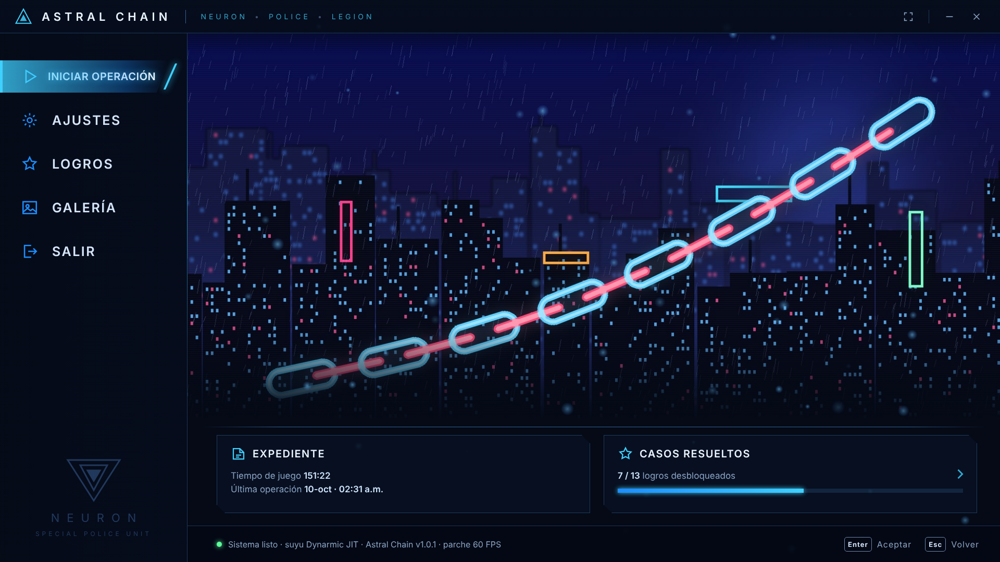
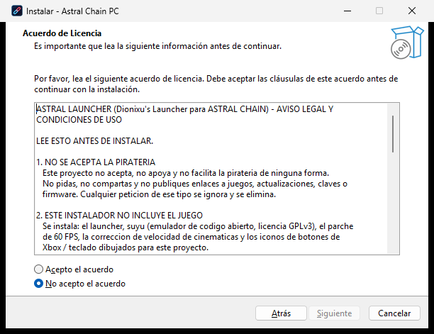
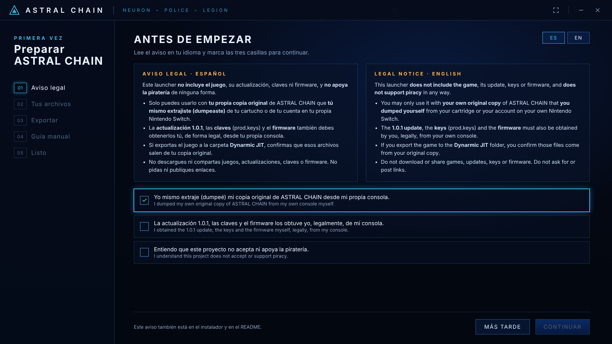
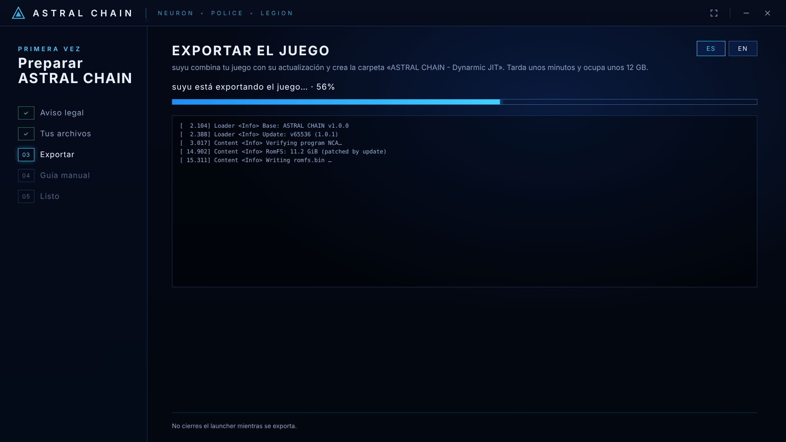
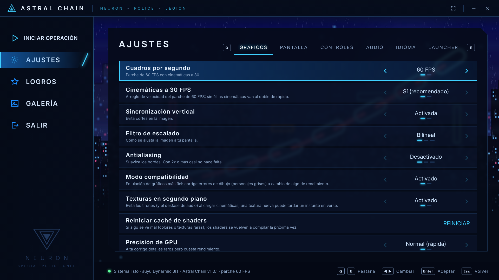
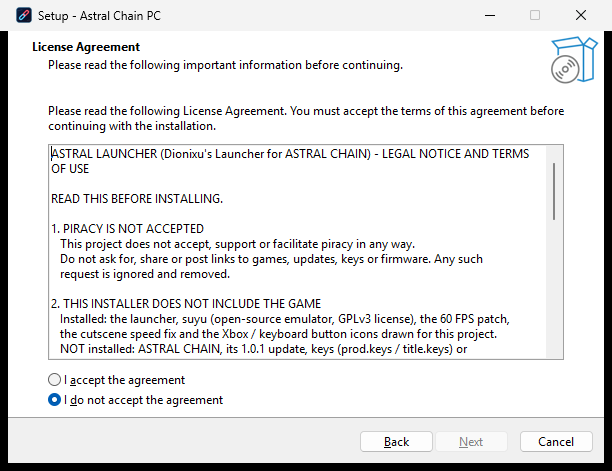
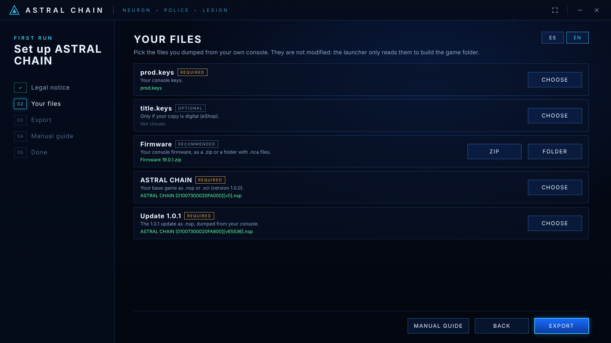
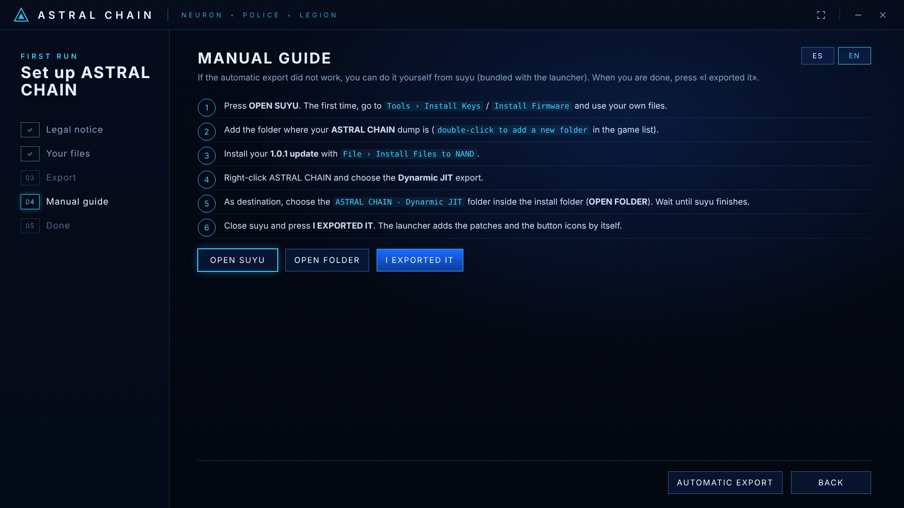
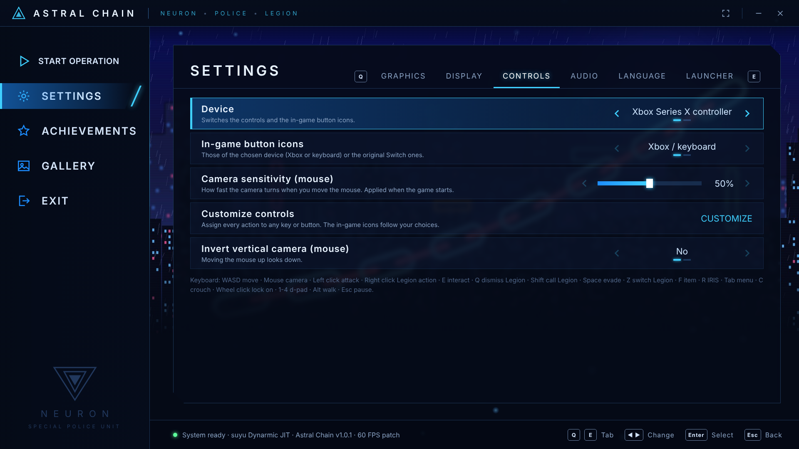

# Astral Launcher — ASTRAL CHAIN en PC a 60 FPS

**[Español](#español) · [English](#english)**

> [!CAUTION]
> **NO SE ACEPTA LA PIRATERÍA · PIRACY IS NOT ACCEPTED**
>
> Este repositorio y su instalador **no incluyen el juego**, su actualización, claves ni firmware.
> Solo funciona con **tu propia copia original** de ASTRAL CHAIN, **extraída (dumpeada) por ti mismo** de tu propia Nintendo Switch.
> La **actualización 1.0.1**, las **claves** y el **firmware** también los tienes que conseguir **tú mismo, de forma legal**, desde tu consola.
> No pidas ni compartas enlaces: esos *issues* se cierran sin respuesta.
>
> This repository and its installer **do not include the game**, its update, keys or firmware.
> It only works with **your own original copy** of ASTRAL CHAIN, **dumped by yourself** from your own Nintendo Switch.
> The **1.0.1 update**, the **keys** and the **firmware** must also be obtained **by you, legally**, from your console.
> Do not ask for or share links: those issues are closed without reply.

---

## Español

Launcher para jugar **ASTRAL CHAIN** en Windows con la exportación **Dynarmic JIT** de suyu, sin la interfaz del emulador:

- **60 FPS** en el juego y **cinemáticas a velocidad correcta** (con su corrección de audio).
- **Iconos de botones de Xbox y de teclado/ratón** dentro del juego (A/B y X/Y en la posición de Xbox).
- **Controles personalizables**: los iconos del juego cambian contigo.
- Menú de **pausa** (Esc o L3 + R3), **capturas con F9**, galería, logros sin conexión.
- **Nombre del oficial** desde el launcher (esta versión no tiene teclado en pantalla).
- Modo de compatibilidad gráfica (arregla el uniforme gris) y decodificación ASTC asíncrona.
- Todo **portátil**: la carpeta se puede mover a otro disco.

### Qué necesitas (todo de tu propia consola)

| | Archivo |
|---|---|
| Obligatorio | `prod.keys` |
| Obligatorio | ASTRAL CHAIN base (`.nsp` o `.xci`, versión 1.0.0) |
| Obligatorio | Actualización **1.0.1** (`.nsp`) |
| Recomendado | Firmware (`.zip` o carpeta con `.nca`) |
| Opcional | `title.keys` (copias digitales) |

Espacio: unos **13 GB** libres.

### Instalación

1. Descarga `AstralLauncher-Setup-x.y.z.exe` desde [Releases](../../releases).
2. Ejecútalo, lee y acepta el aviso legal, y elige una carpeta con permiso de escritura (no “Archivos de programa”).
3. Abre el launcher: aparece el **asistente de primera vez**:
   1. **Aviso legal**: confirmas que el juego es tuyo y lo extrajiste tú.
   2. **Tus archivos**: eliges claves, firmware, juego base y actualización.
   3. **Exportar**: suyu combina el juego con la actualización y crea `ASTRAL CHAIN - Dynarmic JIT`.
   4. Si algo falla, la **guía manual** te lleva paso a paso con suyu (incluido).
4. ¡A jugar! Los parches de 60 FPS y de cinemáticas y los iconos se aplican solos al iniciar.

**Personalizar:** en *Ajustes › Launcher › Carpeta personal* puedes poner tu propio `hero.jpg` (fondo, 1600×760) y `music.mp3` (música del menú). El repositorio no incluye arte ni música del juego.

### Capturas

| | |
|---|---|
|  |  |
|  |  |

---

## English

A launcher to play **ASTRAL CHAIN** on Windows using suyu's **Dynarmic JIT** export, without the emulator UI:

- **60 FPS** gameplay and **correct-speed cutscenes** (with their audio fix).
- **Xbox and keyboard/mouse button icons** in game (A/B and X/Y in Xbox positions).
- **Customizable controls**: the in-game icons follow your choices.
- **Pause** menu (Esc or L3 + R3), **F9 screenshots**, gallery, offline achievements.
- **Officer name** entry from the launcher (this build has no on-screen keyboard).
- Graphics compatibility mode (fixes the grey uniform) and asynchronous ASTC decoding.
- Fully **portable**: the folder can be moved to another drive.

### What you need (all from your own console)

| | File |
|---|---|
| Required | `prod.keys` |
| Required | ASTRAL CHAIN base (`.nsp` or `.xci`, version 1.0.0) |
| Required | **1.0.1** update (`.nsp`) |
| Recommended | Firmware (`.zip` or folder with `.nca` files) |
| Optional | `title.keys` (digital copies) |

Space: about **13 GB** free.

### Installation

1. Download `AstralLauncher-Setup-x.y.z.exe` from [Releases](../../releases).
2. Run it, read and accept the legal notice, and pick a folder you can write to (not “Program Files”).
3. Open the launcher: the **first-run wizard** appears:
   1. **Legal notice**: you confirm the game is yours and you dumped it yourself.
   2. **Your files**: pick keys, firmware, base game and update.
   3. **Export**: suyu merges the game with its update and builds `ASTRAL CHAIN - Dynarmic JIT`.
   4. If something fails, the **manual guide** walks you through it with the bundled suyu.
4. Play! The 60 FPS and cutscene patches and the icons are applied automatically at launch.

**Customize:** in *Settings › Launcher › Personal folder* you can drop your own `hero.jpg` (background, 1600×760) and `music.mp3` (menu music). The repository ships no game art or music.

### Screenshots

| | |
|---|---|
|  |  |
|  |  |

---

## Créditos y licencias / Credits and licenses

- **Launcher** (este repositorio / this repository): [MIT](LICENSE).
- **suyu**: GNU GPL v3, incluido sin modificar / bundled unmodified. Código fuente / source code: ver / see [CREDITS.md](CREDITS.md).
- **Electron**: MIT.
- **Parche de 60 FPS / 60 FPS patch** y **Cutscenes Speed Fix For 60 FPS Patch**: créditos a sus autores originales de la comunidad / credit to their original community authors ([CREDITS.md](CREDITS.md)).
- **ASTRAL CHAIN** © Nintendo / PlatinumGames. Proyecto de aficionados, sin fines de lucro y sin afiliación / Non-profit fan project, not affiliated.

## Compilar / Build

El instalador se genera con GitHub Actions ([build.yml](.github/workflows/build.yml)) en `windows-latest`: descarga Electron, aplica el icono con rcedit, agrega suyu (`SUYU_ZIP_URL` o el Release `suyu-bin`) y compila con Inno Setup. Una etiqueta `v*` publica el Release.

The installer is built by GitHub Actions ([build.yml](.github/workflows/build.yml)) on `windows-latest`: it downloads Electron, sets the icon with rcedit, adds suyu (`SUYU_ZIP_URL` or the `suyu-bin` Release) and compiles with Inno Setup. A `v*` tag publishes the Release.
